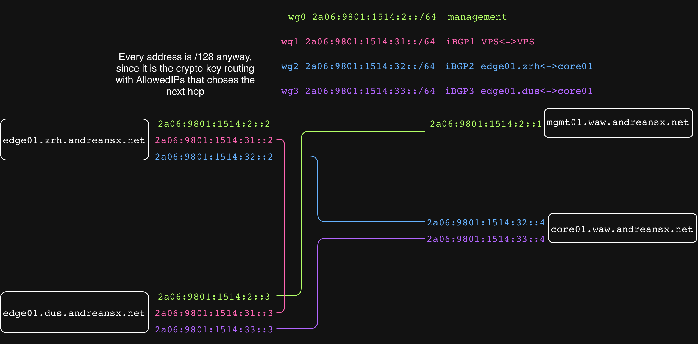

# IPs and interfaces

### WG tunnels diagram 

   

|block|purpose|interface where applicable|
|-:|-:|-:|
|2a06:9801:1514::/48|PA /48||
|2a06:9801:1514:2::/64|Management WG, using /128|wg0|
|2a06:9801:1514:31::/64|iBGP1 WG edge01.zrh <-> edge01.dus, using /128|wg1|
|2a06:9801:1514:32::/64|iBGP2 WG edge01.zrh <-> core01.waw, using /128|wg2|
|2a06:9801:1514:33::/64|iBGP3 WG edge01.dus <-> core01.waw, using /128|wg3|
|2a06:9801:1514:f::/64|unique loopbacks, using /128|lo|
|2a06:9801:1514:a::1/128|Anycasted website and Looking Glass||

### wg0 management
|wg interface|AllowedIPs|peer's endpoint interfaces|address|
|:-|:-|:-|:-|
|(MacBook) mgmt01.waw.andreansx.net wg0|2a06:9801:1514:2::2/128,2a06:9801:1514:2::3/128|wg0 on both VPSes|2a06:9801:1514:2::1/128|
|[edge01.zrh.andreansx.net](../edge01.zrh.andreansx.net) wg0|2a06:9801:1514:2::1/128|wg0 on mgmt01.waw.andreansx.net|2a06:9801:1514:2::2/128|
|[edge01.dus.andreansx.net](../edge01.dus.andreansx.net) wg0|2a06:9801:1514:2::1/128|wg0 on mgmt01.waw.andreansx.net|2a06:9801:1514:2::3/128|

### wg1 iBGP1 (VPS <-> VPS)
|wg interface|AllowedIPs|peer's endpoint interfaces|address|
|:-|:-|:-|:-|
|[edge01.zrh.andreansx.net](../edge01.zrh.andreansx.net) wg1|2a06:9801:1514:31::3/128,::/0|wg1 on [edge01.dus.andreansx.net](../edge01.dus.andreansx.net)|2a06:9801:1514:31::2/128|
|[edge01.dus.andreansx.net](../edge01.dus.andreansx.net) wg1|2a06:9801:1514:31::2/128,::/0|wg1 on [edge01.zrh.andreansx.net](../edge01.zrh.andreansx.net)|2a06:9801:1514:31::3/128|

> [!IMPORTANT]
> `core01.waw.andreansx.net` must have two separate wireguard interfaces, one for each of the VPSes. Both `edge01.zrh.andreansx.net` and `edge01.dus.andreansx.net` from `core01.waw.andreansx.net`'s perspective, must have AllowedIPs set to `::/0`, since the traffic from the entire internet will arrive on `core01.waw.andreansx.net` from one of those two links. However, two peers cannot have overlapping AllowedIPs on one wireguard interface, so `edge01.zrh.andreansx.net` and `edge01.dus.andreansx.net` cannot both at the same time have AllowedIPs set to `::/0`. That is why on `core01.waw.andreansx.net` there will be two wg interfaces, wg2 for connection to `edge01.zrh.andreansx.net`, and wg3 for `edge01.dus.andreansx.net`.   

### wg2 iBGP2 (edge01.zrh <-> core01.waw)
|wg interface|AllowedIPs|peer's endpoint interfaces|address|
|:-|:-|:-|:-|
|[edge01.zrh.andreansx.net](../edge01.zrh.andreansx.net) wg2|2a06:9801:1514:32::4/128,::/0|wg2 on [core01.waw.andreansx.net](../core01.waw.andreansx.net)|2a06:9801:1514:32::2/128|
|[core01.waw.andreansx.net](../core01.waw.andreansx.net) wg2|2a06:9801:1514:32::2/128,::/0|wg2 on [edge01.zrh.andreansx.net](../edge01.zrh.andreansx.net)|2a06:9801:1514:32::4/128|

### wg3 iBGP3 (edge01.dus <-> core01.waw)
|wg interface|AllowedIPs|peer's endpoint interfaces|address|
|:-|:-|:-|:-|
|[edge01.dus.andreansx.net](../edge01.dus.andreansx.net) wg3|2a06:9801:1514:33::4/128,::/0|wg3 on [core01.waw.andreansx.net](../core01.waw.andreansx.net)|2a06:9801:1514:33::3/128|
|[core01.waw.andreansx.net](../core01.waw.andreansx.net) wg3|2a06:9801:1514:33::3/128,::/0|wg3 on [edge01.dus.andreansx.net](../edge01.dus.andreansx.net)|2a06:9801:1514:33::4/128|
