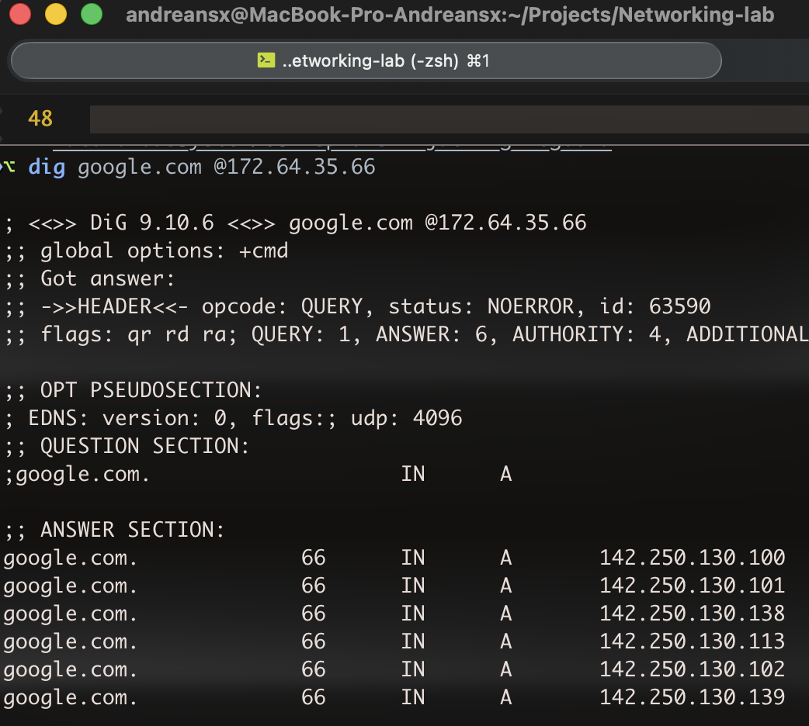
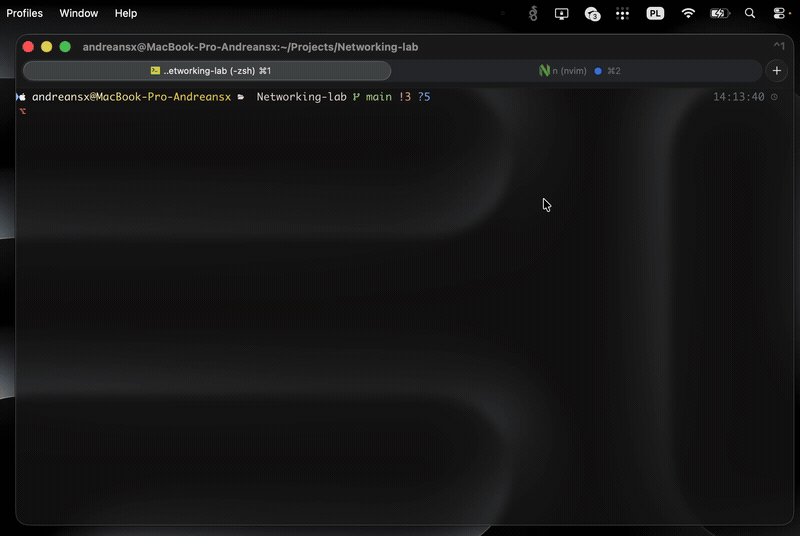
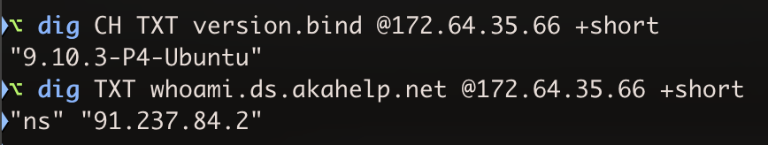
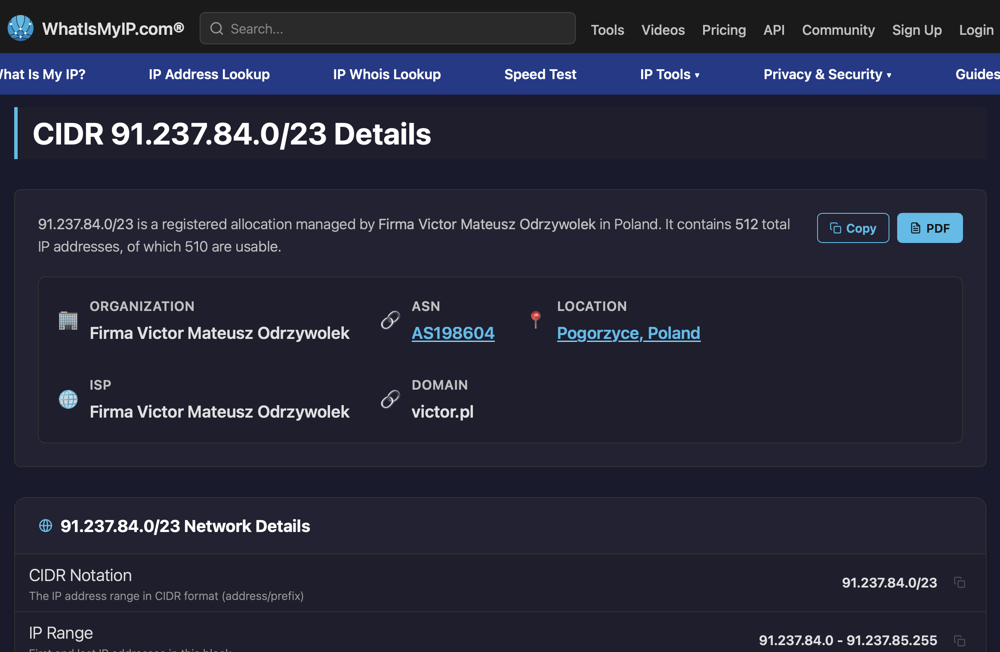

## Basically how I found out that my ISP is doing port 53 hijacking 


I wanted to set up TLS for my domain `*.andreansx.net`. I wanted my ThinkPad to be a central point with a cron job that would renew the certs and handle the Cloudflare DNS API key.   

So first I set the cloudflare api key with `export CLOUDFLARE_DNS_API_TOKEN=...`.
Then I ran `lego run --dns cloudflare -d 'andreansx.net' -d '*.andreansx.net'` which resulted in `dial udp [fd7d:76ee:e68f:a993::1]:53: connect: network is unreachable`.    

I then explicitly stated the DNS resolvers:
```
lego run --dns cloudflare -d 'andreansx.net' -d '*.andreansx.net' --dns.resolvers 1.1.1.1:53
```
And that returned NXDOMAIN, which was really weird. The apex authorization became valid, the wildcard kept failing.
```
2026-10-20T14:36:38.861003388+02:00 ERROR Error error="obtain certificate: resolver: one or more domains had a problem: [*.andreansx.net: dns01: time limit exceeded: last error: recursive nameservers: NS 1.1.1.1:53 returned NXDOMAIN for _acme-challenge.andreansx.net.]
```
The thing is that I checked manually on Cloudflare DNS panel, and there surely was a TXT record for exactly `_acme-challenge.andreansx.net`.
During lego run, the API did list the TXT with the token so the record must have really existed on Cloudflare.    

Then I used static IPs for the authoritative nameservers that my domain uses.   
```
⌥ dig NS andreansx.net +short
sonny.ns.cloudflare.com.
asa.ns.cloudflare.com.
```
Two authoritative nameservers for my domain are `sonny.ns.cloudflare.com` and `asa.ns.cloudflare.com`.   
```
⌥ dig A asa.ns.cloudflare.com +short
172.64.32.246
173.245.58.246
108.162.192.246
⌥ dig A sonny.ns.cloudflare.com +short
172.64.35.66
108.162.195.66
162.159.44.66
```
So I used the static IPs in the lego command, which also failed, again with NXDOMAIN:
```
lego run --dns cloudflare -d 'andreansx.net' -d '*.andreansx.net' --dns.resolvers 172.64.35.66:53 --dns.resolvers 173.245.58.246:53
...
2026-10-20T14:36:36.042973447+02:00 INFO  dns01: waiting for record propagation. domain=.*andreansx.net
  2026-10-20T14:36:38.043839026+02:00 INFO  dns01: cleaning DNS-01 challenge. domain=.*andreansx.net
  2026-10-20T14:36:38.509087744+02:00 INFO  Skipping deactivating of valid authorization. url=https://acme-v02.api.letsencrypt.org/acme/authz/3885694697/803121073587
  2026-10-20T14:36:38.684243877+02:00 INFO  Deactivating authorization. url=https://acme-v02.api.letsencrypt.org/acme/authz/3885694697/803124807097
  2026-10-20T14:36:38.861003388+02:00 ERROR Error error="obtain certificate: resolver: one or more domains had a problem: [*.andreansx.net: dns01: time limit exceeded: last error: recursive nameservers: NS 172.64.35.66:53 returned NXDOMAIN for _acme-challenge.andreansx.net.]
```
So the TXT record with the token does exist at Cloudflare but at the same time, Cloudflare's authoritative NS returns NXDOMAIN??   


I wanted to dump everything along with my Cloudflare API key into claude code but I checked one more thing, which is, if a VPN fixes the NXDOMAIN issue. 
And a VPN did fix it, the whole lego DNS-01 went through even with `--dns.resolvers 1.1.1.1:53` instead of `--dns.resolvers 172.64.35.66:53`.   

This got interesting when Cloudflare's authoritative NS returned an A record for `google.com`:   
   

You can see here that via a VPN, Cloudflare's authoritative NS does not return an A record, it returns REFUSED for `google.com` but without a VPN, it does return an A record:   
   

Also, without VPN, even the wrong address (172.65.35.66 ) does return Google's IPs, which is interesting in itself.   

At this point, the "ISP" in title is not yet proved, since the VPN does bypass both my router and my whole ISP.
However, note, that I am directly connected to my ISP's router and there is no PiHole on my network running.   
And now look at this:
   

And guess who does the `91.237.84.2` IP address shown above belong to.
Of course it is my ISP:   
   

