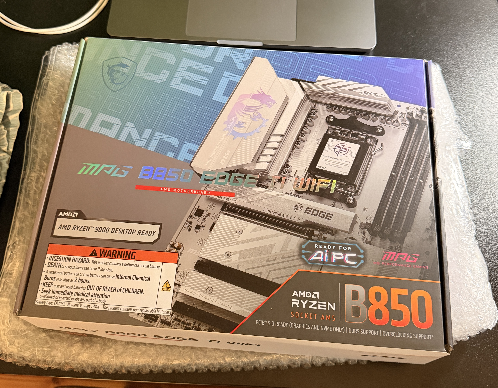

# Hypervisor 03 

This is gonna be a custom pc build, cause I figured that I do not even need a GPU, so that cuts the costs by a lot.   

So for now I have only a MSI MPG B850 EDGE TI WIFI motherboard and I ordered a Ryzen 7 7800x3d.  

   

I still need to get a case and an ssd and cooling and DDR5 RAM.   
