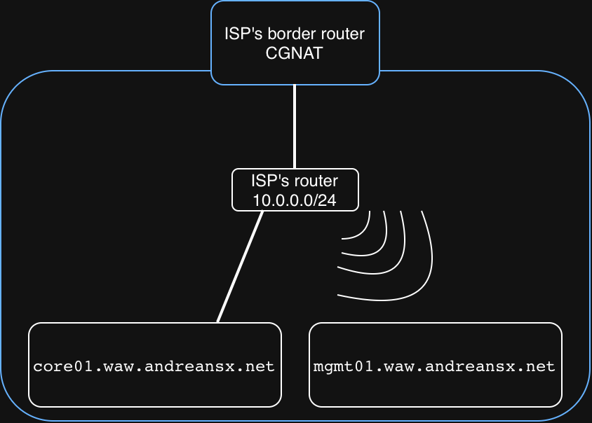
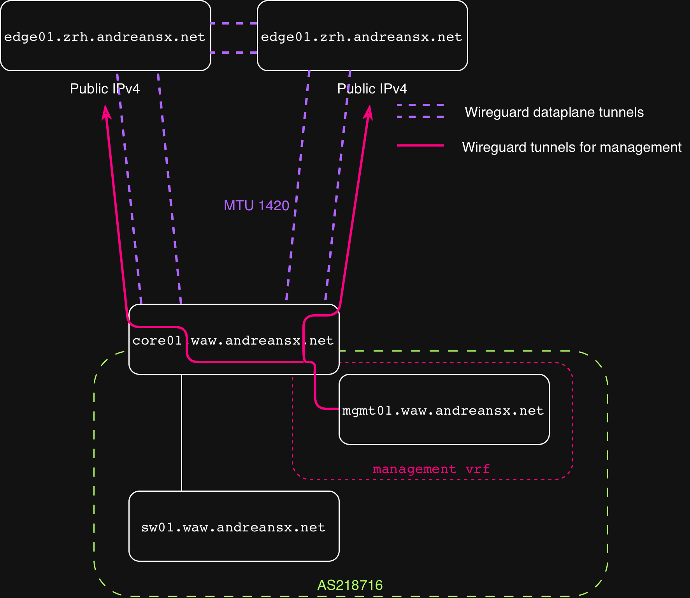

# Technical decisions regarding management VRF

Basically, there will be two sets of wireguard tunnels. The first one is for management (`wg0` interfaces), and the second one is for iBGP and traffic in general ("dataplane" tunnels `wg1-3`; refer to [AutonomousSystem/07-ips-interfaces.md](../../AutonomousSystem/07-ips-interfaces.md)).    
The management tunnels, are initiated from inside my network, not necessarily from inside my AS, but definitely from behind my ISP's CGNAT.
The endpoints for the management tunnels are IPv4 addresses of `edge01.zrh.andreansx.net` and `edge01.dus.andreansx.net`, because my underlay network (home network) does not have IPv6.   

The dataplane tunnels will also be established on IPv4, because, as I said, the underlaying network is IPv4-only.
For now, my Mac is not in my AS, but rather next to it. The path is as follows: ISP's border router with CGNAT, ISP's router in my home, and now here my Mac is connected to the WiFi network, and `core01.waw.andreansx.net` is connected by copper to the router.    
It looks like this:   
   

So now naturally, I would like to have my management device inside my AS. 
However, if `core01.waw.andreansx.net` will route everything from behind it, into the wireguard tunnels to `edge01.zrh.andreansx.net` or `edge01.dus.andreansx.net`, the management tunnels will get routed inside the dataplane tunnels.
This is hard to explain with words so take a look at this diagram, which for me better explains what I am talking about:   

   

MTU inside wireguard tunnel with IPv6 is 1420 Bytes.
That's 1500B minus 40B (ipv6), minus 8B (udp header) and minus another 32B for wireguard itself, so 1500-80=1420.  
Now we have a tunnel with MTU of 1420, and we need to route another wireguard tunnel through it. 
So we get 1420 bytes minus another 80 bytes in total, which puts us at 1340 bytes.   
This is a catastrophic MTU.   

But MTU is not actually the biggest concern here. 
The biggest concern, is that this setup makes seemingly independent management tunnels actually dependent on dataplane tunnels, because for `mgmt01.waw.andreansx.net` to reach `edge01.*.andreansx.net` through `wg0`, both `wg2` and `wg3` must be working.
So if dataplane fails, the control plane also fails, which renders the seemingly out-of-band management, unusable.   

So a simple fix for this issue, is not to make management VRF outbound traffic pass through to wireguard interfaces.   
Basically the default gateway for the management vrf will be `10.0.0.1` (ISP's home router) and it's traffic will not get routed neither to `wg2` nor `wg3`.
This diagram explains what I came up with:   

   

So the management traffic must not be routed through wireguard dataplane tunnels. 
Management tunnels will be established on the underlay IPv4-only network, and not inside the IPv6 wg dataplane.
